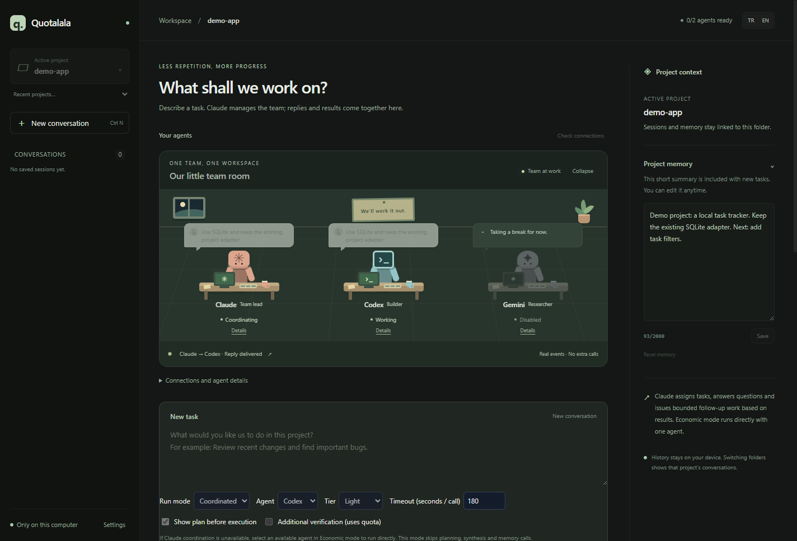
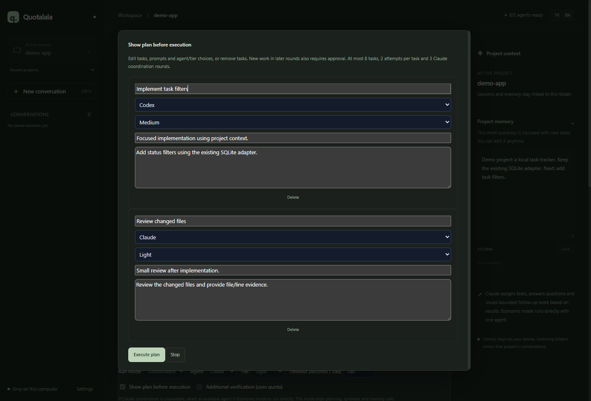
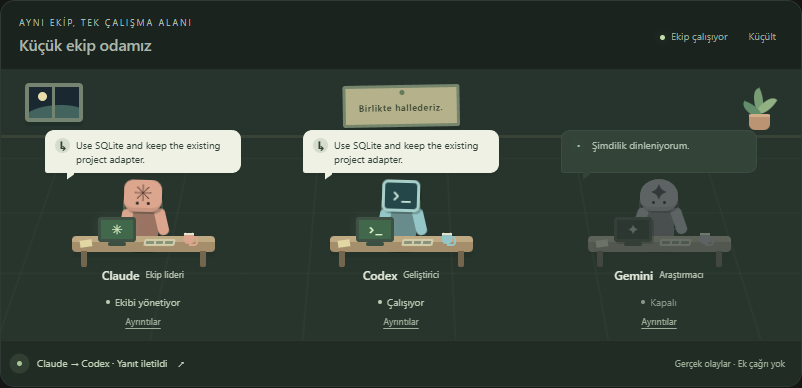

<p align="center">
  
</p>
<h1 align="center">Quotalala</h1>
<p align="center">Un prompt. Tu proyecto. Claude, Codex y Gemini opcional.</p>
<p align="center">
  <a href="README.md">🇬🇧 English</a> · <a href="README.tr.md">🇹🇷 Türkçe</a> · <a href="README.de.md">🇩🇪 Deutsch</a> · <strong>🇪🇸 Español</strong> · <a href="README.fr.md">🇫🇷 Français</a>
</p>
<p align="center">
  <a href="https://www.npmjs.com/package/quotalala">npm</a> · <a href="LICENSE">MIT</a> · Windows · Node.js 22.12+
</p>

Quotalala es una aplicación de escritorio local con Electron que coordina tus CLI de IA con las sesiones ya iniciadas. Ábrela desde tu proyecto y escribe un prompt: Claude planifica el trabajo, reparte las tareas y revisa los resultados. Las conversaciones guardadas y la memoria del proyecto se cargan automáticamente.

## Novedades de 1.1.0

Claude responde preguntas, consulta a otros agentes y asigna correcciones concretas. La sala del equipo muestra eventos reales sin llamadas adicionales a los agentes.

Incluye modo económico, aprobación del plan editable, salida en directo, Detener, tiempos de espera configurables y continuación de pasos incompletos. Los resultados distinguen afirmaciones del agente y pruebas observadas.

Límites: 3 rondas de coordinación, 8 tareas, 2 intentos por tarea y 20 llamadas de prompt por ejecución. Los contadores locales no son tokens ni el saldo exacto de una suscripción.

[Notas de versión](CHANGELOG.md). Actualiza con `npx quotalala@latest` o `npm install -g quotalala@latest`. Estas funciones requieren 1.1.0 o posterior; npm 1.0.0 mantiene las funciones anteriores. No se instala una actualización automática dentro de la aplicación.

## Capturas de pantalla

Interfaz real de Electron con proyecto y mensajes de ejemplo; sin llamadas de suscripción ni historial privado. La interfaz admite inglés y turco.



<details>
<summary>Plan editable con selección de agente y nivel</summary>



</details>

<details>
<summary>Sala del equipo en turco</summary>



</details>

## Inicia desde tu proyecto

Abre una terminal **dentro de la carpeta del proyecto en el que quieres trabajar**:

```powershell
npx quotalala
```

O instala una vez y usa el comando corto:

```powershell
npm install -g quotalala
quotalala
```

La carpeta actual será el directorio de trabajo de los agentes, incluso sin `.git` ni un archivo de configuración del proyecto. Para abrir otra carpeta:

```powershell
quotalala --project "C:\projects\my-app"
```

**Requisitos:** Windows, Node.js 22.12+ y las CLI `claude` y `codex` instaladas y con sesión iniciada. Comprueba el acceso con `claude auth status` y `codex login status`. El agente Gemini opcional utiliza `agy`. La primera instalación con npm descarga Electron; no necesitas otro instalador de Quotalala ni compilación nativa. El comando abre una ventana de escritorio.

## Qué cambia

| Trabajo manual | Con Quotalala |
| --- | --- |
| Repetir el contexto para cada agente | Enviar un prompt; Claude crea un plan |
| Elegir quién hace cada tarea | Ver agente, nivel de modelo y motivo |
| Copiar resultados entre herramientas | El coordinador transmite las salidas |
| Reconstruir dónde te quedaste | Abrir conversaciones, cronología y memoria editable del proyecto |

1. **Planificar:** Claude divide el trabajo usando el estado local de las cuotas y el contexto del proyecto.
2. **Ejecutar:** Las tareas van a Claude, Codex o Gemini si está activado. Un error de cuota puede provocar una transferencia; si un modelo no está disponible, se usa el predeterminado de la CLI.
3. **Revisar:** Claude reúne y comprueba los resultados. La cronología muestra asignaciones, transferencias y errores con entradas y salidas desplegables.

La distribución usa registros locales de uso y errores de cuota. No mide las cuotas del proveedor en tiempo real ni garantiza un consumo menor.

## Una pequeña sala de equipo

La pantalla principal muestra una pequeña oficina: Claude coordina, Codex desarrolla y Gemini investiga si está habilitado. Los escritorios reflejan eventos reales de trabajo, preguntas, respuestas, finalización y cancelación. Pulsa un bocadillo o la franja de mensajes para abrir y copiar el mensaje. Los controles anteriores están en los detalles de conexiones y agentes; la sala puede contraerse.

La vista **no añade llamadas a las CLI**. Las preguntas y respuestas siguen pasando automáticamente por Claude. Gemini desactivado permanece apagado. El historial y los trabajos cancelados no muestran animación de trabajo; se respeta la preferencia de movimiento reducido.

Con la aplicación en segundo plano, las notificaciones silenciosas avisan de resultados, obstáculos o planes pendientes de aprobación. Al pulsarlas se abre la sesión correspondiente sin iniciar ni repetir trabajo. Las conversaciones entre agentes y las cancelaciones manuales no generan avisos. Las notificaciones de tareas se pueden desactivar en Ajustes y no incluyen prompts ni respuestas. Su entrega depende de la configuración del sistema operativo.

## Claude dirige el equipo

En modo coordinado, Claude mantiene el control después del plan inicial. Los agentes envían resultados o preguntas. Claude evalúa juntos los resultados independientes, responde al agente que espera, consulta a otro agente habilitado o crea una tarea de corrección concreta. Preguntas, decisiones y respuestas se muestran como texto seleccionable y copiable en la conversación del equipo y la cronología.

La última respuesta de coordinación incluye la síntesis, sin otra llamada adicional. Se permiten **3 rondas de coordinación** con nivel ligero y un total de **8 tareas, 2 intentos por tarea y 20 llamadas**. Preguntar y continuar tras recibir una respuesta también consume intentos. Los pasos terminados se conservan; las correcciones son pasos nuevos. Con la vista previa activada, el trabajo y las respuestas de rondas posteriores también requieren aprobación editable.

Cada transferencia comparte hasta 3 fragmentos relevantes de 1600 caracteres. Las nuevas llamadas del equipo usan conversaciones CLI nuevas con el contexto necesario; la salida completa queda guardada localmente. Los fragmentos largos pueden truncarse. Al agotarse un límite se entrega un resultado parcial. Los planes antiguos conservan su flujo anterior. Gemini sigue exigiendo aceptación explícita del riesgo; no se garantiza una reducción de cuota.

## Ejecución, cancelación y evidencias

- **Modo económico:** elige un agente y un nivel para ejecutar directamente. Una ejecución correcta usa una llamada de prompt; omite planificación, síntesis, memoria y verificación adicional. Permite trabajar sin coordinación de Claude. La alternativa de modelo/sesión puede añadir un intento.
- **Aprobación del plan:** edita tareas, prompts, motivos y agente/nivel, o elimina tareas. El backend valida de nuevo el plan y la disponibilidad; los modelos siguen procediendo del catálogo verificado.
- Máximo **8 subtareas, 2 intentos por tarea y 20 llamadas por ejecución**. Las alternativas de modelo y agente comparten ese límite. No se repite una operación que ya falló. Tiempo máximo por llamada: **1–1800 segundos**, 180 por defecto; ayuda: 10 segundos.
- La salida en directo se puede seleccionar y copiar. **Detener** termina el árbol de procesos y no inicia tareas pendientes. Cancelación, error y éxito son estados distintos; se conservan los resultados parciales. Continuar reutiliza el plan y evita ejecutar otra vez los pasos correctos. No revierte los cambios de pasos incompletos.
- Se separa lo declarado por el agente de lo no verificado independientemente. Se muestran metadatos de archivos, referencias de archivo/línea y comandos/códigos de salida expuestos por la CLI (actualmente Codex). Las revisiones requieren referencias; las explicaciones generales no. La síntesis no es una prueba independiente; la verificación adicional opcional consume cuota.
- Tras ejecuciones coordinadas correctas con resultados nuevos, Claude actualiza un resumen editable de hasta **2000 caracteres**. La planificación recibe hasta **20 títulos de eventos**.
- Una segunda instancia transmite el proyecto a la ventana existente. Si hay trabajo activo, espera; el directorio de la tarea no cambia. Los archivos temporales únicos protegen las escrituras atómicas. Las sesiones interrumpidas se detectan al iniciar y pueden continuarse.

Los metadatos no prueban la corrección del contenido. Los controles sin eventos estructurados siguen siendo declaraciones del agente. Algunas CLI almacenan la salida hasta terminar; un cierre inesperado puede perder el último segundo de texto en directo. La recuperación requiere guardar el historial. Windows está probado; macOS/Linux y la primera migración de historiales grandes siguen pendientes.

## Memoria del proyecto

- Las conversaciones se agrupan por proyecto. Puedes abrir, renombrar, eliminar o continuar una sesión.
- Tras ejecuciones coordinadas correctas con resultados nuevos, Claude actualiza un resumen editable de hasta **2000 caracteres**. La planificación recibe hasta **20 títulos de eventos**.
- Se usa la continuación nativa de la CLI si el soporte está verificado y existe un identificador exacto de sesión. En caso contrario, la memoria aporta el contexto. No se importan otras conversaciones de las CLI.
- Puedes seleccionar y copiar salidas y registros. Filtra por nivel o agente; las tarjetas de error incluyen una solución sugerida y la salida original para copiar.

`Ctrl+N` abre una conversación y `Ctrl+Enter` envía el prompt. La interfaz está en turco e inglés; las traducciones del README no añaden idiomas a la interfaz.

## Datos locales y permisos

Sin claves API, lectura de archivos de credenciales, proxies ni cuentas compartidas. Los prompts se envían por stdin a las CLI oficiales con tus propias cuentas. Las sesiones y la memoria se guardan como JSON en `~/.quotalala/sessions/` y `~/.quotalala/memory/`. En Ajustes puedes desactivar el guardado o borrar el historial; la memoria se puede editar o restablecer. Las CLI pueden conservar sus propias transcripciones.

Las claves y los tokens reconocibles se enmascaran antes de guardar. Los patrones no detectan todos los secretos; revisa los diagnósticos antes de compartirlos. Abrir una carpeta no evita las restricciones de la CLI. Un proceso que termina sin error no basta para considerar completada una revisión bloqueada.

> **Gemini está desactivado de forma predeterminada.** Para activar `agy` hay que aceptar el aviso de riesgo de su tarjeta. El aviso explica las restricciones de cuentas notificadas en relación con el uso automatizado. No se incluyen nombres de modelos Gemini sin verificación en el equipo de desarrollo.

## Instalador de escritorio

También se puede generar un instalador NSIS para Windows, que no requiere Node.js:

```powershell
& "C:\path\to\Quotalala.exe" --project "C:\projects\my-app"
```

Si ejecutas la aplicación desde una carpeta con `.git`, `AGENTS.md` o `package.json`, detectará el proyecto. En caso contrario, recuperará el último proyecto. La barra lateral permite cambiar de proyecto o abrir la primera carpeta. Todavía no hay una Release con el instalador; el instalador verificado localmente no está firmado.

<details>
<summary><strong>Desarrollo, pruebas y empaquetado</strong></summary>

Desde el repositorio Quotalala clonado:

```powershell
npm ci
npm start
npm test
npm run test:ui
npm run test:startup
npm run test:instance
npm run check
npm run pack:cli
npm run build -- --win --publish never
```

Usa `npm start -- --project "C:\projects\my-app"` para probar otro proyecto. Las pruebas utilizan CLI simuladas y datos locales de ejemplo. Las pruebas de cuota reales requieren permiso explícito: [AGENTS.md](AGENTS.md).

`pack:cli` genera un archivo npm independiente con una versión fijada de Electron y valida su lista de archivos. Publica el archivo generado, no el manifiesto de desarrollo de la raíz. En la compilación NSIS, Electron sigue siendo una dependencia de desarrollo. Estos comandos no publican automáticamente.

Los modelos y sus fuentes están en `~/.quotalala/models.json`, editable en Ajustes. Los modelos preview no se eligen de forma predeterminada. El descubrimiento automático de modelos y los niveles de razonamiento de Gemini siguen pendientes. El soporte para macOS y Linux está previsto.

Comprobaciones de publicación y avisos conocidos de dependencias de compilación: [RELEASE-CHECKLIST.md](RELEASE-CHECKLIST.md). La aplicación usa un renderer aislado, aislamiento de contexto y un puente IPC limitado. Backend: `src/main/`; interfaz: `src/renderer/`.

</details>

## Licencia

[MIT](LICENSE) · Quotalala Contributors
